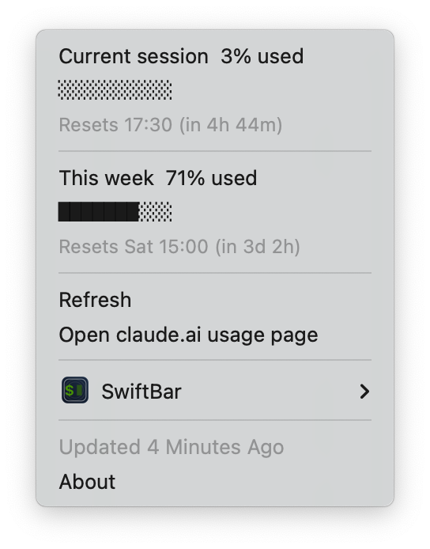

# UsageBar

[English](README.md) | 简体中文

在 macOS 菜单栏显示 Claude 套餐的用量，包括**当前会话**（5 小时窗口）和**本周**两项，每项都有已用百分比和重置时间。数据和 Claude 用量设置页里看到的一致。

<p>
  
</p>
<p>
  <picture>
    <source media="(prefers-color-scheme: dark)" srcset="docs/images/menu-dark.png">
    
  </picture>
</p>

任意一项用量达到 75% 时菜单栏文字变橙色，达到 90% 时变红色。点击任意用量行即可刷新。

> [!IMPORTANT]
> UsageBar 是**非官方**的社区项目，和 Anthropic 没有任何关联，也没有得到 Anthropic 的认可或支持。它用到的是未公开文档的接口，随时可能变化或失效。

## 环境要求

- macOS
- [SwiftBar](https://github.com/swiftbar/SwiftBar)（推荐）或 [xbar](https://xbarapp.com)
- 已登录的 [Claude Code](https://docs.claude.com/en/docs/claude-code)：运行一次 `claude` 并登录你的 Claude 账号
- `jq`：macOS 15 及以上自带，更早的版本运行 `brew install jq` 安装

## 安装

```sh
brew install --cask swiftbar
git clone https://github.com/JayJay1024/usagebar-for-claude.git
```

打开 SwiftBar 并选择一个插件目录，然后把插件软链接进去：

```sh
ln -s "$PWD/usagebar-for-claude/plugin/usagebar.5m.sh" "<你的 SwiftBar 插件目录>/"
```

用软链接的好处是，之后 `git pull` 就能更新插件。

### 刷新间隔

刷新间隔写在文件名里：`usagebar.5m.sh` 表示每 5 分钟刷新一次。要修改的话，把软链接改个名就行，例如 `usagebar.1m.sh` 或 `usagebar.15m.sh`。请不要低于 1 分钟，以免请求接口太频繁。

## 工作原理

1. 从 macOS 钥匙串的 `Claude Code-credentials` 条目读取 Claude Code 的 OAuth 凭据。
2. 请求 `GET https://api.anthropic.com/api/oauth/usage`，拿到的就是 Claude 用量页面上显示的数据。
3. 把结果按 SwiftBar 的菜单格式输出。

## 安全性

UsageBar 用到的 token 拥有访问你 Claude 账号的权限，所以它遵守以下规则：

- **只读**：从不写入钥匙串。
- **从不刷新 token**：refresh token 是轮换的，如果在这里刷新，可能导致 Claude Code 被登出。token 过期时，UsageBar 会提示你运行 `claude`，由它来刷新。
- **只和 `api.anthropic.com` 通信**：没有统计、遥测，也不接任何第三方服务。
- **不存储、不记录**：token 只保存在内存中，并通过 stdin 传给 `curl`，所以不会出现在进程列表里。

整个插件只有一个 shell 脚本，建议安装前先读一遍：[`plugin/usagebar.5m.sh`](plugin/usagebar.5m.sh)。

## 常见问题

| 提示 | 处理方法 |
| --- | --- |
| Claude Code credentials not found | 安装 Claude Code，然后运行 `claude` 登录。 |
| Claude token expired / rejected | 运行一次 `claude` 刷新 token，UsageBar 下次刷新时会自动用上新的。 |
| jq not found | 运行 `brew install jq`，或者把 `USAGEBAR_JQ` 设为你的 jq 路径。 |
| Unexpected response / HTTP 错误 | 未公开的接口可能变了。请检查有没有新版本，或者提一个 issue。 |

## 配置

可选的环境变量：

| 变量 | 默认值 | 说明 |
| --- | --- | --- |
| `USAGEBAR_KEYCHAIN_SERVICE` | `Claude Code-credentials` | 要读取的钥匙串条目 |
| `USAGEBAR_JQ` | 自动检测 | `jq` 的路径 |

## 开发

```sh
./tests/run.sh
```

测试会离线渲染 `tests/fixtures/` 里的 JSON 样例，不访问钥匙串，也不联网。手动调试时，设置 `USAGEBAR_FIXTURE` 和 `USAGEBAR_NOW` 也能达到同样效果。

### 参与贡献

- 在分支上修改，然后提 Pull Request，不要直接推送到 `main`。
- commit 信息遵循 [Conventional Commits](https://www.conventionalcommits.org/zh-hans/)，例如 `feat: …`、`fix: …`、`docs: …`。
- 文档同时维护英文和中文两个版本，修改时请同步更新 `README.md` 和 `README.zh-CN.md`。

## 许可证

[MIT](LICENSE)
